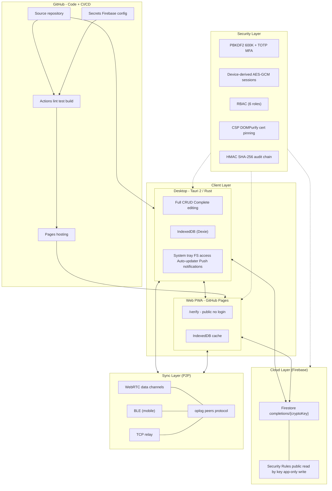
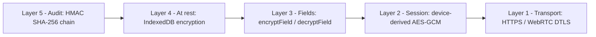
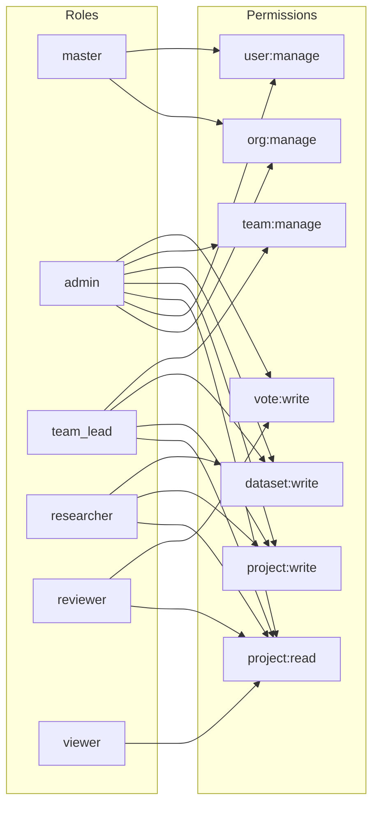
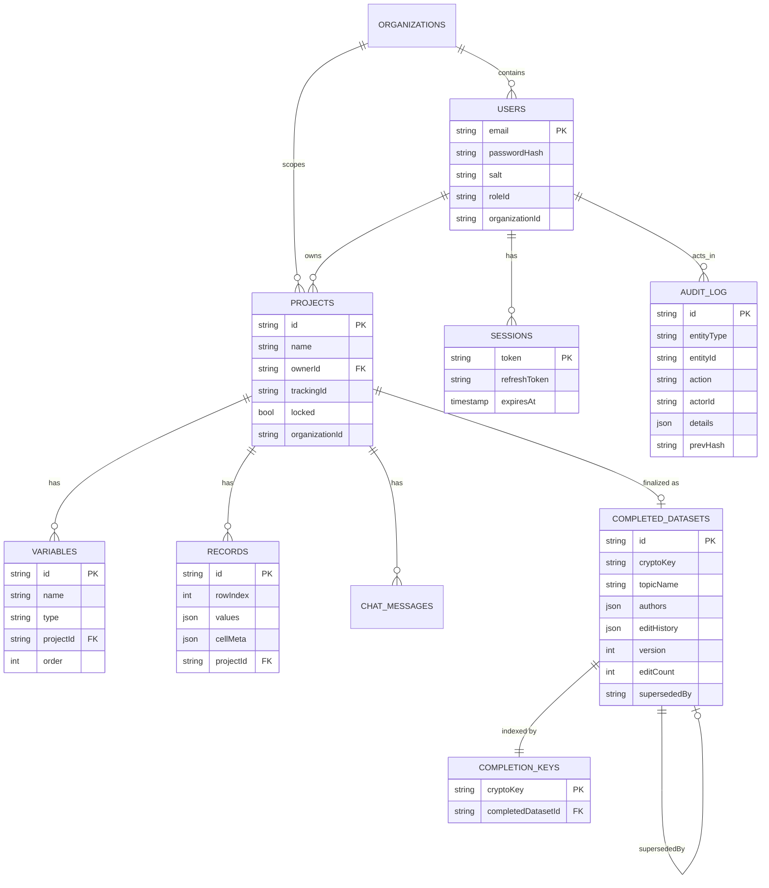
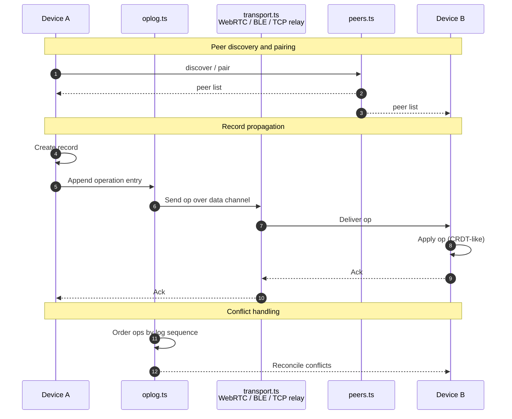
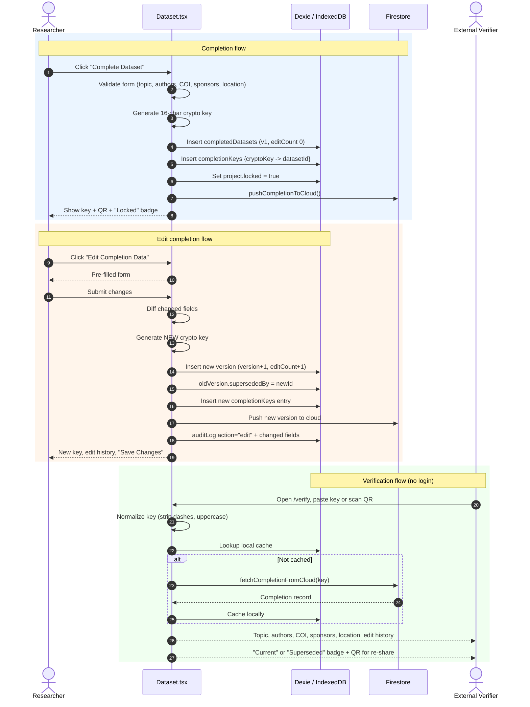
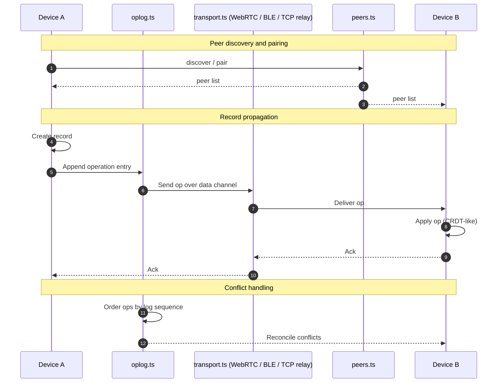

# Zaydian Research Integrity (ZRI)

An offline-first research data governance and integrity platform by Ahsan Mandhar.

<p align="center">
  
</p>

<p align="center">
  <a href="https://github.com/ahsanmandhar-ui/zaydian-research-integrity">
    
  </a>
  <a href="https://ahsanmandhar-ui.github.io/zaydian-research-integrity/">
    
  </a>
  <a href="https://ahsanmandhar-ui.github.io/zaydian-research-integrity/#/verify">
    
  </a>
  
  
</p>

---

## 1. Project Overview

Zaydian Research Integrity (ZRI) is designed to help research teams manage projects, control access to research data, maintain auditable records of changes, and verify dataset versions.

The platform aims to combine research project management, data collection, dataset versioning, cryptographic verification, and collaboration in a unified environment.

Its architectural direction emphasizes local-first operation, allowing researchers to work with locally stored data and synchronize with other participants when a communication path is available.

---

## 2. Core Features

### Research Project Management
- Create and organize research projects.
- Assign team members and project-specific roles.
- Manage project documentation and research milestones.
- Support controlled project completion and approval workflows.

### Role-Based Access Control
- Restrict operations according to assigned permissions.
- Separate administrative, research, and data-collection responsibilities.
- Support accountability by associating recorded actions with user accounts.

### Research Data Collection
- Collect and manage structured research data.
- Apply validation rules to reduce data-entry errors.
- Maintain project-specific datasets.
- Support controlled data amendments and exports.

### Audit Trails and Dataset Versioning
- Record relevant research activities and dataset changes.
- Maintain identifiable dataset versions.
- Track the relationship between finalized and subsequently amended datasets.
- Support verification of recorded changes and dataset history.

### Cryptographic Dataset Verification
- Generate cryptographic fingerprints for datasets or finalized records.
- Provide a mechanism for checking whether a dataset matches a previously registered version.
- Support verification of completion records and superseded versions.
- Help identify unauthorized modifications to data covered by the verification mechanism.

Cryptographic verification establishes consistency with recorded evidence; it does not independently establish that the original observations are scientifically accurate or genuine.

### Offline-First Operation
- Prioritize local data access and storage.
- Reduce dependence on continuously available central infrastructure.
- Support research workflows in environments with unreliable internet connectivity.

### Peer-to-Peer Collaboration
- Support direct synchronization between participating devices where the implemented networking configuration permits.
- Facilitate the exchange of permitted research records.
- Address synchronization conflicts and changes made while devices are disconnected.

### Research Analysis and Reporting
- Provide a foundation for connecting datasets with research analysis workflows.
- Support the traceability of data used in research outputs.
- Offer opportunities for linking dataset versions with statistical results and manuscript preparation.

The availability of individual analysis, synchronization, and verification functions depends on the capabilities implemented in the current release.
---

## 3. Architectural Principles

ZRI is guided by the following principles:

- **Local-first design**: Researchers should be able to work with locally available data without depending on a continuously connected central server.
- **Accountability**: Relevant actions should be attributable to authenticated users.
- **Controlled access**: Users should only be able to perform operations permitted by their roles and project assignments.
- **Traceability**: Dataset changes and finalization events should have an identifiable history.
- **Verifiability**: Cryptographic mechanisms should help reviewers establish whether a dataset matches a registered version.
- **Data minimization**: External verification should disclose only the information necessary for the verification task.
- **Resource efficiency**: The architecture should be practical for research teams with limited infrastructure and budgets.

---

## 4. Security and Research Integrity

ZRI is intended to strengthen research-data governance through access controls, recorded changes, versioned datasets, and cryptographic verification.

These mechanisms can improve accountability and help detect certain forms of unauthorized modification.

They do not guarantee that data entered by a researcher are truthful, that a study is free from fabrication, or that its statistical conclusions are valid. Those questions require additional scientific, procedural, and institutional safeguards.

---

## 5. Continuous Integration and Delivery

The repository includes automated development and verification workflows via GitHub Actions.

The CI/CD pipeline executes linting, unit tests, and production builds on every push. Deployment to GitHub Pages is automated and completes in approximately 2 minutes.

These capabilities are confirmed by the repository's workflow configuration in `.github/workflows/`.

---

## 6. Intended Users

ZRI is intended for:

- Medical students and academic researchers.
- Clinical and observational research teams.
- University research departments.
- Research coordinators and data managers.
- Institutions seeking more structured research-data governance.
- Collaborators working across locations with intermittent connectivity.

---

## 7. Project Status

ZRI is a developing software project. Its documented features, implemented functionality, and independently validated security properties should be distinguished clearly.

Before institutional or clinical deployment, the platform requires appropriate testing of access controls, data protection, synchronization, recovery, audit integrity, and operational reliability.

---

## 8. Project Vision

The long-term goal is to make research-data governance more accessible by integrating project administration, controlled data collection, traceable amendments, and independently verifiable dataset histories into a practical local-first platform.

Zaydian Research Integrity aims to make research data easier to govern, changes easier to trace, and dataset histories easier to verify.
---

## 3. Architectural Principles

ZRI is guided by the following principles:

- **Local-first design**: Researchers should be able to work with locally available data without depending on a continuously connected central server.
- **Accountability**: Relevant actions should be attributable to authenticated users.
- **Controlled access**: Users should only be able to perform operations permitted by their roles and project assignments.
- **Traceability**: Dataset changes and finalization events should have an identifiable history.
- **Verifiability**: Cryptographic mechanisms should help reviewers establish whether a dataset matches a registered version.
- **Data minimization**: External verification should disclose only the information necessary for the verification task.
- **Resource efficiency**: The architecture should be practical for research teams with limited infrastructure and budgets.

---

## 4. Security and Research Integrity

ZRI is intended to strengthen research-data governance through access controls, recorded changes, versioned datasets, and cryptographic verification.

These mechanisms can improve accountability and help detect certain forms of unauthorized modification.

They do not guarantee that data entered by a researcher are truthful, that a study is free from fabrication, or that its statistical conclusions are valid. Those questions require additional scientific, procedural, and institutional safeguards.

---

## 5. Continuous Integration and Delivery

The repository includes automated development and verification workflows via GitHub Actions.

The CI/CD pipeline executes linting, unit tests, and production builds on every push. Deployment to GitHub Pages is automated and completes in approximately 2 minutes.

These capabilities are confirmed by the repository's workflow configuration in `.github/workflows/`.

---

## 6. Intended Users

ZRI is intended for:

- Medical students and academic researchers.
- Clinical and observational research teams.
- University research departments.
- Research coordinators and data managers.
- Institutions seeking more structured research-data governance.
- Collaborators working across locations with intermittent connectivity.

---

## 7. Project Status

ZRI is a developing software project. Its documented features, implemented functionality, and independently validated security properties should be distinguished clearly.

Before institutional or clinical deployment, the platform requires appropriate testing of access controls, data protection, synchronization, recovery, audit integrity, and operational reliability.

---

## 8. Project Vision

The long-term goal is to make research-data governance more accessible by integrating project administration, controlled data collection, traceable amendments, and independently verifiable dataset histories into a practical local-first platform.

Zaydian Research Integrity aims to make research data easier to govern, changes easier to trace, and dataset histories easier to verify.
---

## 3. Architectural Principles

ZRI is guided by the following principles:

- **Local-first design**: Researchers should be able to work with locally available data without depending on a continuously connected central server.
- **Accountability**: Relevant actions should be attributable to authenticated users.
- **Controlled access**: Users should only be able to perform operations permitted by their roles and project assignments.
- **Traceability**: Dataset changes and finalization events should have an identifiable history.
- **Verifiability**: Cryptographic mechanisms should help reviewers establish whether a dataset matches a registered version.
- **Data minimization**: External verification should disclose only the information necessary for the verification task.
- **Resource efficiency**: The architecture should be practical for research teams with limited infrastructure and budgets.

---

## 4. Security and Research Integrity

ZRI is intended to strengthen research-data governance through access controls, recorded changes, versioned datasets, and cryptographic verification.

These mechanisms can improve accountability and help detect certain forms of unauthorized modification.

They do not guarantee that data entered by a researcher are truthful, that a study is free from fabrication, or that its statistical conclusions are valid. Those questions require additional scientific, procedural, and institutional safeguards.

---

## 5. Continuous Integration and Delivery

The repository includes automated development and verification workflows via GitHub Actions.

The CI/CD pipeline executes linting, unit tests, and production builds on every push. Deployment to GitHub Pages is automated and completes in approximately 2 minutes.

These capabilities are confirmed by the repository's workflow configuration in `.github/workflows/`.

---

## 6. Intended Users

ZRI is intended for:

- Medical students and academic researchers.
- Clinical and observational research teams.
- University research departments.
- Research coordinators and data managers.
- Institutions seeking more structured research-data governance.
- Collaborators working across locations with intermittent connectivity.

---

## 7. Project Status

ZRI is a developing software project. Its documented features, implemented functionality, and independently validated security properties should be distinguished clearly.

Before institutional or clinical deployment, the platform requires appropriate testing of access controls, data protection, synchronization, recovery, audit integrity, and operational reliability.

---

## 8. Project Vision

The long-term goal is to make research-data governance more accessible by integrating project administration, controlled data collection, traceable amendments, and independently verifiable dataset histories into a practical local-first platform.

Zaydian Research Integrity aims to make research data easier to govern, changes easier to trace, and dataset histories easier to verify.
---

## 3. Architectural Principles

ZRI is guided by the following principles:

- **Local-first design**: Researchers should be able to work with locally available data without depending on a continuously connected central server.
- **Accountability**: Relevant actions should be attributable to authenticated users.
- **Controlled access**: Users should only be able to perform operations permitted by their roles and project assignments.
- **Traceability**: Dataset changes and finalization events should have an identifiable history.
- **Verifiability**: Cryptographic mechanisms should help reviewers establish whether a dataset matches a registered version.
- **Data minimization**: External verification should disclose only the information necessary for the verification task.
- **Resource efficiency**: The architecture should be practical for research teams with limited infrastructure and budgets.

---

## 4. Security and Research Integrity

ZRI is intended to strengthen research-data governance through access controls, recorded changes, versioned datasets, and cryptographic verification.

These mechanisms can improve accountability and help detect certain forms of unauthorized modification.

They do not guarantee that data entered by a researcher are truthful, that a study is free from fabrication, or that its statistical conclusions are valid. Those questions require additional scientific, procedural, and institutional safeguards.

---

## 5. Continuous Integration and Delivery

The repository includes automated development and verification workflows via GitHub Actions.

The CI/CD pipeline executes linting, unit tests, and production builds on every push. Deployment to GitHub Pages is automated and completes in approximately 2 minutes.

These capabilities are confirmed by the repository's workflow configuration in `.github/workflows/`.

---

## 6. Intended Users

ZRI is intended for:

- Medical students and academic researchers.
- Clinical and observational research teams.
- University research departments.
- Research coordinators and data managers.
- Institutions seeking more structured research-data governance.
- Collaborators working across locations with intermittent connectivity.

---

## 7. Project Status

ZRI is a developing software project. Its documented features, implemented functionality, and independently validated security properties should be distinguished clearly.

Before institutional or clinical deployment, the platform requires appropriate testing of access controls, data protection, synchronization, recovery, audit integrity, and operational reliability.

---

## 8. Project Vision

The long-term goal is to make research-data governance more accessible by integrating project administration, controlled data collection, traceable amendments, and independently verifiable dataset histories into a practical local-first platform.

Zaydian Research Integrity aims to make research data easier to govern, changes easier to trace, and dataset histories easier to verify.
---

## 3. Architectural Principles

ZRI is guided by the following principles:

- **Local-first design**: Researchers should be able to work with locally available data without depending on a continuously connected central server.
- **Accountability**: Relevant actions should be attributable to authenticated users.
- **Controlled access**: Users should only be able to perform operations permitted by their roles and project assignments.
- **Traceability**: Dataset changes and finalization events should have an identifiable history.
- **Verifiability**: Cryptographic mechanisms should help reviewers establish whether a dataset matches a registered version.
- **Data minimization**: External verification should disclose only the information necessary for the verification task.
- **Resource efficiency**: The architecture should be practical for research teams with limited infrastructure and budgets.

---

## 4. Security and Research Integrity

ZRI is intended to strengthen research-data governance through access controls, recorded changes, versioned datasets, and cryptographic verification.

These mechanisms can improve accountability and help detect certain forms of unauthorized modification.

They do not guarantee that data entered by a researcher are truthful, that a study is free from fabrication, or that its statistical conclusions are valid. Those questions require additional scientific, procedural, and institutional safeguards.

---

## 5. Continuous Integration and Delivery

The repository includes automated development and verification workflows via GitHub Actions.

The CI/CD pipeline executes linting, unit tests, and production builds on every push. Deployment to GitHub Pages is automated and completes in approximately 2 minutes.

These capabilities are confirmed by the repository's workflow configuration in `.github/workflows/`.

---

## 6. Intended Users

ZRI is intended for:

- Medical students and academic researchers.
- Clinical and observational research teams.
- University research departments.
- Research coordinators and data managers.
- Institutions seeking more structured research-data governance.
- Collaborators working across locations with intermittent connectivity.

---

## 7. Project Status

ZRI is a developing software project. Its documented features, implemented functionality, and independently validated security properties should be distinguished clearly.

Before institutional or clinical deployment, the platform requires appropriate testing of access controls, data protection, synchronization, recovery, audit integrity, and operational reliability.

---

## 8. Project Vision

The long-term goal is to make research-data governance more accessible by integrating project administration, controlled data collection, traceable amendments, and independently verifiable dataset histories into a practical local-first platform.

Zaydian Research Integrity aims to make research data easier to govern, changes easier to trace, and dataset histories easier to verify.
---

## 3. Architectural Principles

ZRI is guided by the following principles:

- **Local-first design**: Researchers should be able to work with locally available data without depending on a continuously connected central server.
- **Accountability**: Relevant actions should be attributable to authenticated users.
- **Controlled access**: Users should only be able to perform operations permitted by their roles and project assignments.
- **Traceability**: Dataset changes and finalization events should have an identifiable history.
- **Verifiability**: Cryptographic mechanisms should help reviewers establish whether a dataset matches a registered version.
- **Data minimization**: External verification should disclose only the information necessary for the verification task.
- **Resource efficiency**: The architecture should be practical for research teams with limited infrastructure and budgets.

---

## 4. Security and Research Integrity

ZRI is intended to strengthen research-data governance through access controls, recorded changes, versioned datasets, and cryptographic verification.

These mechanisms can improve accountability and help detect certain forms of unauthorized modification.

They do not guarantee that data entered by a researcher are truthful, that a study is free from fabrication, or that its statistical conclusions are valid. Those questions require additional scientific, procedural, and institutional safeguards.

---

## 5. Continuous Integration and Delivery

The repository includes automated development and verification workflows via GitHub Actions.

The CI/CD pipeline executes linting, unit tests, and production builds on every push. Deployment to GitHub Pages is automated and completes in approximately 2 minutes.

These capabilities are confirmed by the repository's workflow configuration in `.github/workflows/`.

---

## 6. Intended Users

ZRI is intended for:

- Medical students and academic researchers.
- Clinical and observational research teams.
- University research departments.
- Research coordinators and data managers.
- Institutions seeking more structured research-data governance.
- Collaborators working across locations with intermittent connectivity.

---

## 7. Project Status

ZRI is a developing software project. Its documented features, implemented functionality, and independently validated security properties should be distinguished clearly.

Before institutional or clinical deployment, the platform requires appropriate testing of access controls, data protection, synchronization, recovery, audit integrity, and operational reliability.

---

## 8. Project Vision

The long-term goal is to make research-data governance more accessible by integrating project administration, controlled data collection, traceable amendments, and independently verifiable dataset histories into a practical local-first platform.

Zaydian Research Integrity aims to make research data easier to govern, changes easier to trace, and dataset histories easier to verify.
---

## How ZRI Acts as "Hive"

ZRI operates as a **decentralized research integrity network** — a "Hive" where independent organizations operate with end-to-end encryption and mutual verification.

### The Hive Model

```
        Org A (Hospital)  <-->  Org B (University)  <-->  Org C (Lab)
              |                        |                        |
              +-----------+------------+-----------+------------+
                          |                        |
                   Sync Layer (BLE/TCP)      Verify (Public)
```

### Key Principles

1. **Independent Organizations** — Each org operates autonomously with its own users, projects, and datasets
2. **End-to-End Encryption** — All data encrypted at rest (AES-GCM) and in transit (WebRTC DTLS)
3. **Mutual Verification** — Completion keys allow cross-org dataset authenticity verification
4. **Admin Verification** — Admin identities verified before granting organization access
5. **Privacy by Design** — Patient phone numbers and emails are non-exportable
6. **Anti-Fake-Data** — Designed specifically to prevent AI-generated datasets in research

### Verification Flow Across the Hive

```
Org A (PC)                    Cloud (Firebase)              Org B (Web)
┌────────────┐               ┌──────────────┐              ┌────────────┐
│ Complete   │  push key     │ completions/ │  fetch by    │ Paste key  │
│ dataset    │ ──────────►  │ {key} → data │ ◄──────────  │ Verify     │
│ Get key    │               │              │              │ See metadata│
│ Show QR    │  share key    │              │              │ Show QR    │
└────────────┘ ──────────►  └──────────────┘  ◄────────── └────────────┘
```

---

## Features

### Core
- **Offline-First** — Full functionality without internet (IndexedDB + Service Worker)
- **RBAC** — Project-scoped permissions (master, admin, researcher, reviewer, viewer, team_lead)
- **Audit Logging** — HMAC SHA-256 tamper-evident audit chain (32+ entries)
- **Session Security** — Device-derived AES-GCM encryption, PBKDF2 600K iterations, MFA support
- **Data-at-Rest** — Encrypted fields, CSP headers, DOMPurify XSS protection

### Dataset Management
- **Spreadsheet Interface** — Excel-like grid with type validation (numeric, string, date, boolean)
- **Dataset Locking** — Prevents edits when project.locked = true (after completion)
- **Edit Tracking** — Blue-highlighted edit history with changed fields and timestamps
- **Version Control** — Each edit creates a new version with incremented version number
- **Key Superseding** — Old keys show "Superseded" badge, new keys show "Current"

### Dataset Authenticity Verification
- **16-Character Crypto Keys** — Human-readable keys (e.g., H5XJ-63MF-X92X-JBAR)
- **QR Code Generation** — Scan to share verification keys
- **Cross-Org Verification** — Verify datasets across organizations via public /verify page
- **Cloud Sync** — Firebase Firestore stores completion records (public read by key)
- **No Login Required** — External users can verify without an account

### Sync & Collaboration
- **P2P Sync** — WebRTC data channels for device-to-device sync
- **BLE Transport** — Bluetooth Low Energy for mobile sync
- **TCP Relay** — Network relay for restrictive networks
- **Org-Scoped Isolation** — Data syncs within organization boundaries

### Analytics & Reporting
- **Data Quality Dashboard** — Missingness, distributions, outliers, edit tracking
- **Meta-Analysis Module** — Forest plots, heterogeneity stats, export (SVG/PNG/CSV/JSON)

### Security
- **MFA Enforcement** — Multi-factor authentication support
- **Rate Limiting** — Login attempt throttling
- **Certificate Pinning** — Prevents MITM attacks
- **Backup Encryption** — Encrypted backup/restore
- **Session Expiry Warning** — Alerts before session timeout

---

## Architecture

### System Architecture



### Security Layers



### RBAC Permissions



### Data Model



### Complete and Verify Flow

```mermaid
sequenceDiagram
    autonumber
    actor U as Researcher
    participant DS as Dataset.tsx
    participant DB as Dexie / IndexedDB
    participant FB as Firestore
    actor V as External Verifier

    rect rgb(235, 245, 255)
    Note over U,FB: Completion flow
    U->>DS: Click "Complete Dataset"
    DS->>DS: Validate form (topic, authors, COI, sponsors, location)
    DS->>DS: Generate 16-char crypto key
    DS->>DB: Insert completedDatasets (v1, editCount 0)
    DS->>DB: Insert completionKeys {cryptoKey -> datasetId}
    DS->>DB: Set project.locked = true
    DS->>FB: pushCompletionToCloud()
    DS-->>U: Show key + QR + "Locked" badge
    end

    rect rgb(255, 245, 235)
    Note over U,DB: Edit completion flow
    U->>DS: Click "Edit Completion Data"
    DS-->>U: Pre-filled form
    U->>DS: Submit changes
    DS->>DS: Diff changed fields
    DS->>DS: Generate NEW crypto key
    DS->>DB: Insert new version (version+1, editCount+1)
    DS->>DB: oldVersion.supersededBy = newId
    DS->>DB: Insert new completionKeys entry
    DS->>FB: Push new version to cloud
    DS->>DB: auditLog action="edit" + changed fields
    DS-->>U: New key, edit history, "Save Changes"
    end

    rect rgb(240, 255, 240)
---

## Architecture

### System Architecture

```mermaid
flowchart TB
    subgraph CLIENTS["Client Layer"]
        direction LR
        subgraph DESK["Desktop - Tauri 2 / Rust"]
            D1["Full CRUD Complete editing"]
            D2["IndexedDB (Dexie)"]
            D3["System tray FS access Auto-updater Push notifications"]
        end
        subgraph WEB["Web PWA - GitHub Pages"]
            W1["/verify - public no login"]
            W2["IndexedDB cache"]
        end
    end

    subgraph CLOUD["Cloud Layer (Firebase)"]
        F1["Firestore completions/{cryptoKey}"]
        F2["Security Rules public read by key app-only write"]
    end

    subgraph GH["GitHub - Code + CI/CD"]
        G1["Source repository"]
        G2["Actions lint test build"]
        G3["Pages hosting"]
        G4["Secrets Firebase config"]
    end

    subgraph SYNC["Sync Layer (P2P)"]
        S1["WebRTC data channels"]
        S2["BLE (mobile)"]
        S3["TCP relay"]
        S4["oplog peers protocol"]
    end

    subgraph SEC["Security Layer"]
        SEC1["PBKDF2 600K + TOTP MFA"]
        SEC2["Device-derived AES-GCM sessions"]
        SEC3["RBAC (6 roles)"]
        SEC4["CSP DOMPurify cert pinning"]
        SEC5["HMAC SHA-256 audit chain"]
    end

    DESK <--> WEB
    DESK <--> F1
    WEB <--> F1
    F1 --- F2

    DESK <--> SYNC
    WEB <--> SYNC
    S1 --- S4
    S2 --- S4
    S3 --- S4

    G1 --> G2
    G2 --> G3
    G3 --> WEB
    G4 --> G2
    G1 --> DESK

    SEC -.-> DESK
    SEC -.-> WEB
    SEC -.-> CLOUD
```

### Security Layers


### RBAC Permissions


    Note over V,DB: Verification flow (no login)
    V->>DS: Open /verify, paste key or scan QR
    DS->>DS: Normalize key (strip dashes, uppercase)
    DS->>DB: Lookup local cache
    alt Not cached
        DS->>FB: fetchCompletionFromCloud(key)
        FB-->>DS: Completion record
        DS->>DB: Cache locally
    end
    DS-->>V: Topic, authors, COI, sponsors, location, edit history
    DS-->>V: "Current" or "Superseded" badge + QR for re-share
    end
```

### P2P Sync Flow




### Tech Stack
| Layer | Technology |
|-------|-----------|
| Frontend | React 19 + TypeScript + Vite |
| Styling | CSS (custom, glassmorphism) |
| Local DB | Dexie (IndexedDB) |
| Desktop | Tauri 2 (Rust) |
| Cloud | Firebase Firestore |
| Hosting | GitHub Pages |
| CI/CD | GitHub Actions |
| PWA | Vite PWA (service worker) |
| Crypto | Web Crypto API (AES-GCM, PBKDF2, HMAC) |
| QR Code | qrcode (npm) |

---

---

## Architecture

### System Architecture


### Data Model


### Complete and Verify Flow



### P2P Sync Flow



### Tech Stack

| Layer | Technology |
|-------|-----------|
| Frontend | React 19 + TypeScript + Vite |
| Styling | CSS (custom, glassmorphism) |
| Local DB | Dexie (IndexedDB) |
| Desktop | Tauri 2 (Rust) |
| Cloud | Firebase Firestore |
| Hosting | GitHub Pages |
| CI/CD | GitHub Actions |
| PWA | Vite PWA (service worker) |
| Crypto | Web Crypto API (AES-GCM, PBKDF2, HMAC) |
| QR Code | qrcode (npm) |

---

## Links

| Resource | URL |
|----------|-----|
| **GitHub Repo** | https://github.com/ahsanmandhar-ui/zaydian-research-integrity |
| **Live App** | https://ahsanmandhar-ui.github.io/zaydian-research-integrity/ |
| **Verify Dataset** | https://ahsanmandhar-ui.github.io/zaydian-research-integrity/#/verify |
| **License** | Permission Required (All Rights Reserved) |

---

## Getting Started

### Prerequisites
- Node.js 18+
- Rust (for Tauri desktop build)
- Firebase project (for cloud sync)

### Setup
```bash
git clone https://github.com/ahsanmandhar-ui/zaydian-research-integrity.git
cd zaydian-research-integrity
npm install
cp .env.example .env
# Fill in your Firebase config values
npm run dev
```

### Desktop Build
```bash
npm run tauri build
# Installer: src-tauri/target/release/bundle/nsis/
```

---

## License

**Permission Required License** — Copyright (c) 2026 Zaydian Research. All Rights Reserved.

No person may use, copy, modify, merge, publish, distribute, sublicense, or sell copies of this Software without prior written permission from Zaydian Research.

For permission requests, contact: ahsanmandhar@gmail.com

See [LICENSE](LICENSE) for full terms.
## Links

| Resource | URL |
|----------|-----|
| **GitHub Repo** | https://github.com/ahsanmandhar-ui/zaydian-research-integrity |
| **Live App** | https://ahsanmandhar-ui.github.io/zaydian-research-integrity/ |
| **Verify Dataset** | https://ahsanmandhar-ui.github.io/zaydian-research-integrity/#/verify |
| **License** | Permission Required (All Rights Reserved) |

---

## Getting Started

### Prerequisites
- Node.js 18+
- Rust (for Tauri desktop build)
- Firebase project (for cloud sync)

### Setup
```bash
git clone https://github.com/ahsanmandhar-ui/zaydian-research-integrity.git
cd zaydian-research-integrity
npm install
cp .env.example .env
# Fill in your Firebase config values
npm run dev
```

### Desktop Build
```bash
npm run tauri build
# Installer: src-tauri/target/release/bundle/nsis/
```

---

## License

**Permission Required License** — Copyright (c) 2026 Zaydian Research. All Rights Reserved.

No person may use, copy, modify, merge, publish, distribute, sublicense, or sell copies of this Software without prior written permission from Zaydian Research.

For permission requests, contact: ahsanmandhar@gmail.com

See [LICENSE](LICENSE) for full terms.
