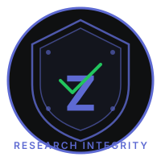

# Zaydian Research Integrity (ZRI)

> **Secure, offline-first research data governance platform** — prevent fake data, verify authenticity, govern with RBAC.

<p align="center">
  
</p>

<p align="center">
  <a href="https://github.com/ahsanmandhar-ui/zaydian-research-integrity">
    
  </a>
  <a href="https://ahsanmandhar-ui.github.io/zaydian-research-integrity/">
    
  </a>
  <a href="https://ahsanmandhar-ui.github.io/zaydian-research-integrity/#/verify">
    
  </a>
  
  
</p>
---

## How ZRI Acts as "Hive"

ZRI operates as a **decentralized research integrity network** — a "Hive" where independent organizations operate with end-to-end encryption and mutual verification.

### The Hive Model

```
        Org A (Hospital)  <-->  Org B (University)  <-->  Org C (Lab)
              |                        |                        |
              +-----------+------------+-----------+------------+
                          |                        |
                   Sync Layer (BLE/TCP)      Verify (Public)
```

### Key Principles

1. **Independent Organizations** — Each org operates autonomously with its own users, projects, and datasets
2. **End-to-End Encryption** — All data encrypted at rest (AES-GCM) and in transit (WebRTC DTLS)
3. **Mutual Verification** — Completion keys allow cross-org dataset authenticity verification
4. **Admin Verification** — Admin identities verified before granting organization access
5. **Privacy by Design** — Patient phone numbers and emails are non-exportable
6. **Anti-Fake-Data** — Designed specifically to prevent AI-generated datasets in research

### Verification Flow Across the Hive

```
Org A (PC)                    Cloud (Firebase)              Org B (Web)
┌────────────┐               ┌──────────────┐              ┌────────────┐
│ Complete   │  push key     │ completions/ │  fetch by    │ Paste key  │
│ dataset    │ ──────────►  │ {key} → data │ ◄──────────  │ Verify     │
│ Get key    │               │              │              │ See metadata│
│ Show QR    │  share key    │              │              │ Show QR    │
└────────────┘ ──────────►  └──────────────┘  ◄────────── └────────────┘
```

---

## Features

### Core
- **Offline-First** — Full functionality without internet (IndexedDB + Service Worker)
- **RBAC** — Project-scoped permissions (master, admin, researcher, reviewer, viewer, team_lead)
- **Audit Logging** — HMAC SHA-256 tamper-evident audit chain (32+ entries)
- **Session Security** — Device-derived AES-GCM encryption, PBKDF2 600K iterations, MFA support
- **Data-at-Rest** — Encrypted fields, CSP headers, DOMPurify XSS protection

### Dataset Management
- **Spreadsheet Interface** — Excel-like grid with type validation (numeric, string, date, boolean)
- **Dataset Locking** — Prevents edits when project.locked = true (after completion)
- **Edit Tracking** — Blue-highlighted edit history with changed fields and timestamps
- **Version Control** — Each edit creates a new version with incremented version number
- **Key Superseding** — Old keys show "Superseded" badge, new keys show "Current"

### Dataset Authenticity Verification
- **16-Character Crypto Keys** — Human-readable keys (e.g., H5XJ-63MF-X92X-JBAR)
- **QR Code Generation** — Scan to share verification keys
- **Cross-Org Verification** — Verify datasets across organizations via public /verify page
- **Cloud Sync** — Firebase Firestore stores completion records (public read by key)
- **No Login Required** — External users can verify without an account

### Sync & Collaboration
- **P2P Sync** — WebRTC data channels for device-to-device sync
- **BLE Transport** — Bluetooth Low Energy for mobile sync
- **TCP Relay** — Network relay for restrictive networks
- **Org-Scoped Isolation** — Data syncs within organization boundaries

### Analytics & Reporting
- **Data Quality Dashboard** — Missingness, distributions, outliers, edit tracking
- **Meta-Analysis Module** — Forest plots, heterogeneity stats, export (SVG/PNG/CSV/JSON)

### Security
- **MFA Enforcement** — Multi-factor authentication support
- **Rate Limiting** — Login attempt throttling
- **Certificate Pinning** — Prevents MITM attacks
- **Backup Encryption** — Encrypted backup/restore
- **Session Expiry Warning** — Alerts before session timeout

---

## Architecture

### Tech Stack
| Layer | Technology |
|-------|-----------|
| Frontend | React 19 + TypeScript + Vite |
| Styling | CSS (custom, glassmorphism) |
| Local DB | Dexie (IndexedDB) |
| Desktop | Tauri 2 (Rust) |
| Cloud | Firebase Firestore |
| Hosting | GitHub Pages |
| CI/CD | GitHub Actions |
| PWA | Vite PWA (service worker) |
| Crypto | Web Crypto API (AES-GCM, PBKDF2, HMAC) |
| QR Code | qrcode (npm) |

---

## Links

| Resource | URL |
|----------|-----|
| **GitHub Repo** | https://github.com/ahsanmandhar-ui/zaydian-research-integrity |
| **Live App** | https://ahsanmandhar-ui.github.io/zaydian-research-integrity/ |
| **Verify Dataset** | https://ahsanmandhar-ui.github.io/zaydian-research-integrity/#/verify |
| **License** | Permission Required (All Rights Reserved) |

---

## Getting Started

### Prerequisites
- Node.js 18+
- Rust (for Tauri desktop build)
- Firebase project (for cloud sync)

### Setup
```bash
git clone https://github.com/ahsanmandhar-ui/zaydian-research-integrity.git
cd zaydian-research-integrity
npm install
cp .env.example .env
# Fill in your Firebase config values
npm run dev
```

### Desktop Build
```bash
npm run tauri build
# Installer: src-tauri/target/release/bundle/nsis/
```

---

## License

**Permission Required License** — Copyright (c) 2026 Zaydian Research. All Rights Reserved.

No person may use, copy, modify, merge, publish, distribute, sublicense, or sell copies of this Software without prior written permission from Zaydian Research.

For permission requests, contact: ahsanmandhar@gmail.com

See [LICENSE](LICENSE) for full terms.
