# Zaydian Research Integrity — Project Plan

> **Status:** approved · **Version:** 1.0 · **Updated:** 2026-10-23
> **Approved by:** PENDING — do not start execution

---

## 1. Vision

Zaydian Research Integrity is a locally-persistent, collaborative research governance and data-management platform for a medical college research cell. It manages the full research lifecycle — proposals, council voting, project workspaces, SPSS-style datasets, analytics, publications — without a central research database, with role-based access control and auditable offline-capable synchronization. Success looks like: an institution can run its entire research cell offline-capable with no feature loss and a verifiable traceability matrix at delivery.

## 2. Scope

### In scope (v1)
- All 40 features transcribed in features.md (proposed; pending approval)
- Local-first PWA with IndexedDB
- RBAC, invitations, council voting, project workspaces
- SPSS-style Variable/Data View, validation, import/export
- Analytics dashboard + 9 advanced sections + Published Vault + department dashboards
- Offline sync (institution-controlled relay initial)
- Demo mode with synthetic data

### Out of scope (v1, explicitly)
- Hosted central research database — prohibited by architecture
- Real patient data in demo — prohibited
- Gmail-specific identity dependency — use verified email identity

## 3. Users and roles

See requirements §2 (System Owner, Research Cell Admin, Admin Council Member, Research Head, plus project team roles). Full matrix to be finalized in discovery.

## 4. Architecture

### 4.1 Shape
UI (React+TS+Vite) ⇄ local store (IndexedDB via Dexie) ⇄ CRDT (Yjs, proposed) ⇄ outbox ⇄ institution-controlled encrypted relay

### 4.2 Data flow for a single write
1. user action
2. write to local store — immediately, synchronously visible
3. apply CRDT update → persist update
4. enqueue in outbox
5. background sync when peer/relay reachable
6. peers apply update; convergence guaranteed by CRDT

### 4.3 Storage
| What | Where | Why |
|---|---|---|
| Primary data | IndexedDB (Dexie) | browser-local, durable |
| Attachments | OPFS blobs by hash | large binary off main store |
| Sync metadata | separate store | rebuildable independently |
| Keys | platform keystore | OS-level protection |

### 4.4 Sync topology
**Decision:** institution-controlled encrypted relay initial (Mode B/C hybrid) — see ADR to be recorded. Direct P2P (Mode A) added later without redesign.

### 4.5 Security model
TLS in transit; encryption at rest for sensitive records; least-privilege RBAC; device enrollment/revocation; audited admin actions.

### 4.6 Accessibility
Target WCAG 2.2 AA.

## 5. Tech stack — and why

| Layer | Choice | Reason | Rejected alternative |
|---|---|---|---|
| Language | TypeScript | type safety across FE/BE | JavaScript |
| UI framework | React | ecosystem, virtualized grids | Vue/Svelte |
| Build | Vite | fast dev, PWA plugin | Webpack |
| Local storage | IndexedDB (Dexie) | robust wrapper, offline | raw IDB |
| CRDT | Yjs (proposed) | mature, small | Automerge |
| Sync transport | institution relay (proposed) | reliable queueing | P2P-only |
| Styling | Tailwind CSS (proposed) | utility, consistent | CSS modules |
| Testing | Vitest + Playwright (proposed) | fast unit + E2E | Jest |
| Packaging | PWA | installable, offline | Tauri (desktop later) |

## 6. Task graph
To be built in Phase D after plan approval.

## 7. Milestones

| ID | Name | Goal | Features | Gate |
|---|---|---|---|---|
| M0 | Foundation | repo, CI, tokens, brand, auth bootstrap, RBAC | F-001,F-002,F-005,F-028,F-035 | build + lint green |
| M1 | Data core | local storage, sync engine skeleton, data model | F-003,F-004,F-028,F-030,F-035 | offline cold-start test |
| M2 | Governance & workspace | proposals, voting, project workspace, UI nav | F-006..F-011,F-034 | task gates + a11y |
| M3 | Data engine | Variable/Data View, forms, import/export, versioning | F-012..F-020 | data tests |
| M4 | Analytics & integrity | validation, audit, analytics, published vault, reports | F-021..F-027,F-033 | analytics reference match |
| M5 | Sync & security | sync modes, conflict handling, encryption, backups | F-029,F-031,F-032 | convergence suite |
| M6 | Demo & release | demo mode, reset/removal, integrity tests, docs | F-036..F-040 | final gate |

## 8. Risks

| # | Risk | Likelihood | Impact | Mitigation | Owner |
|---|---|---|---|---|---|
| R1 | Sync convergence bugs surface late | M | H | Convergence tests in M1 | Sync Engineer |
| R2 | Scope growth | M | M | Weekly traceability audit; Admin-only scope changes | Orchestrator |
| R3 | PII leakage in analytics | L | H | Field-level permission checks; small-cell suppression | Security Engineer |

## 9. Quality budget

| Metric | Budget |
|---|---|
| Cold start to interactive (offline, mid-range) | < 2.5s |
| Local write → UI | < 100ms |
| Initial bundle (compressed) | < 250KB |
| Accessibility | WCAG 2.2 AA, zero serious/critical axe findings |

## 10. Definition of Done (project level)

- [ ] 100% of Admin-approved features `verified` in the traceability matrix
- [ ] All milestone gates passed with recorded evidence
- [ ] Full suite green from a clean clone
- [ ] Installs and runs offline on a fresh machine
- [ ] No stubs, TODOs, or mock data in delivered code
- [ ] Docs complete and every command in them verified
- [ ] Final report + demo script delivered

## Changelog

| Version | Date | Author | Change | Reason |
|---|---|---|---|---|
| 1.0 | 2026-10-23 | Principal Architect | Initial draft | — |

## Live task graph

<!-- GRAPH:BEGIN -->
<!-- generated by plot_graph.py on render — do not hand-edit this block -->
**26 tasks** — pending: 26

```mermaid
%% rendered by plot_graph.py — do not hand-edit
flowchart LR
    classDef pending fill:#F1F3F4,stroke:#9AA0A6,color:#3C4043,stroke-width:1.5px
    classDef ready fill:#E8F0FE,stroke:#4285F4,color:#174EA6,stroke-width:1.5px
    classDef running fill:#FEF7E0,stroke:#F9AB00,color:#7A4F01,stroke-width:1.5px
    classDef review fill:#F3E8FD,stroke:#A142F4,color:#5B1A9E,stroke-width:1.5px
    classDef blocked fill:#FCE8E6,stroke:#EA4335,color:#A50E0E,stroke-width:1.5px
    classDef done fill:#E6F4EA,stroke:#34A853,color:#0D652D,stroke-width:1.5px
    classDef dropped fill:#F8F9FA,stroke:#BDC1C6,color:#80868B,stroke-width:1.5px
    classDef critical stroke:#1A73E8,stroke-width:3px

    T_001["<b>T-001</b><br/>Project scaffold (Vite+React+TS+Dexie)<br/><span style="font-size:11px">frontend-engineer</span>"]:::pending,critical
    T_002["<b>T-002</b><br/>Auth & RBAC data model (users, roles, invitations)<br/><span style="font-size:11px">backend-engineer</span>"]:::pending,critical
    T_003["<b>T-003</b><br/>Dexie schema & migrations (core entities)<br/><span style="font-size:11px">database-engineer</span>"]:::pending,critical
    T_004["<b>T-004</b><br/>Demo data module (isolated, removable)<br/><span style="font-size:11px">frontend-engineer</span>"]:::pending
    T_005["<b>T-005</b><br/>Sync operation log & durable queue (P2P)<br/><span style="font-size:11px">sync-engineer</span>"]:::pending
    T_006["<b>T-006</b><br/>Peer identity & QR/manual pairing<br/><span style="font-size:11px">security-engineer</span>"]:::pending
    T_007["<b>T-007</b><br/>WebRTC transport adapter (encrypted)<br/><span style="font-size:11px">sync-engineer</span>"]:::pending
    T_008["<b>T-008</b><br/>Conflict resolution engine<br/><span style="font-size:11px">sync-engineer</span>"]:::pending
    T_009["<b>T-009</b><br/>Synchronization Center UI<br/><span style="font-size:11px">frontend-engineer</span>"]:::pending
    T_010["<b>T-010</b><br/>Sync simulation lab (demo)<br/><span style="font-size:11px">frontend-engineer</span>"]:::pending
    T_011["<b>T-011</b><br/>Project workspace & memberships<br/><span style="font-size:11px">frontend-engineer</span>"]:::pending
    T_012["<b>T-012</b><br/>Council voting engine (immutable votes)<br/><span style="font-size:11px">backend-engineer</span>"]:::pending
    T_013["<b>T-013</b><br/>Project links & permissions<br/><span style="font-size:11px">frontend-engineer</span>"]:::pending
    T_014["<b>T-014</b><br/>Variable View (SPSS-style)<br/><span style="font-size:11px">frontend-engineer</span>"]:::pending,critical
    T_015["<b>T-015</b><br/>Data View grid + validation<br/><span style="font-size:11px">frontend-engineer</span>"]:::pending,critical
    T_016["<b>T-016</b><br/>Import/export (CSV/Excel/SPSS)<br/><span style="font-size:11px">backend-engineer</span>"]:::pending
    T_017["<b>T-017</b><br/>Versioning & submission events<br/><span style="font-size:11px">backend-engineer</span>"]:::pending,critical
    T_018["<b>T-018</b><br/>Analytics engine & 5 KPIs<br/><span style="font-size:11px">frontend-engineer</span>"]:::pending,critical
    T_019["<b>T-019</b><br/>Advanced analytics sections (9)<br/><span style="font-size:11px">frontend-engineer</span>"]:::pending,critical
    T_020["<b>T-020</b><br/>Published Vault<br/><span style="font-size:11px">frontend-engineer</span>"]:::pending,critical
    T_021["<b>T-021</b><br/>Department dashboards<br/><span style="font-size:11px">frontend-engineer</span>"]:::pending
    T_022["<b>T-022</b><br/>UI shell, navigation & WCAG 2.2 AA<br/><span style="font-size:11px">ui-ux-designer</span>"]:::pending
    T_023["<b>T-023</b><br/>Encryption & sensitive data handling<br/><span style="font-size:11px">security-engineer</span>"]:::pending
    T_024["<b>T-024</b><br/>Backups & restore<br/><span style="font-size:11px">devops-release</span>"]:::pending
    T_025["<b>T-025</b><br/>Test automation setup (Vitest+Playwright)<br/><span style="font-size:11px">test-automation-engineer</span>"]:::pending
    T_026["<b>T-026</b><br/>Documentation & threat model<br/><span style="font-size:11px">technical-writer</span>"]:::pending

    T_001 ==> T_002
    T_001 ==> T_003
    T_002 ==> T_003
    T_003 ==> T_004
    T_003 ==> T_005
    T_005 ==> T_006
    T_006 ==> T_007
    T_005 ==> T_008
    T_007 ==> T_009
    T_008 ==> T_009
    T_009 ==> T_010
    T_002 ==> T_011
    T_003 ==> T_011
    T_011 ==> T_012
    T_011 ==> T_013
    T_003 ==> T_014
    T_014 ==> T_015
    T_015 ==> T_016
    T_015 ==> T_017
    T_015 ==> T_018
    T_017 ==> T_018
    T_018 ==> T_019
    T_019 ==> T_020
    T_019 ==> T_021
    T_001 ==> T_022
    T_005 ==> T_023
    T_007 ==> T_023
    T_003 ==> T_024
    T_001 ==> T_025
    T_025 ==> T_026

    linkStyle 0 stroke:#1A73E8,stroke-width:3px
    linkStyle 1 stroke:#1A73E8,stroke-width:3px
    linkStyle 2 stroke:#1A73E8,stroke-width:3px
    linkStyle 15 stroke:#1A73E8,stroke-width:3px
    linkStyle 16 stroke:#1A73E8,stroke-width:3px
    linkStyle 18 stroke:#1A73E8,stroke-width:3px
    linkStyle 19 stroke:#1A73E8,stroke-width:3px
    linkStyle 20 stroke:#1A73E8,stroke-width:3px
    linkStyle 21 stroke:#1A73E8,stroke-width:3px
    linkStyle 22 stroke:#1A73E8,stroke-width:3px
```

<!-- GRAPH:END -->
